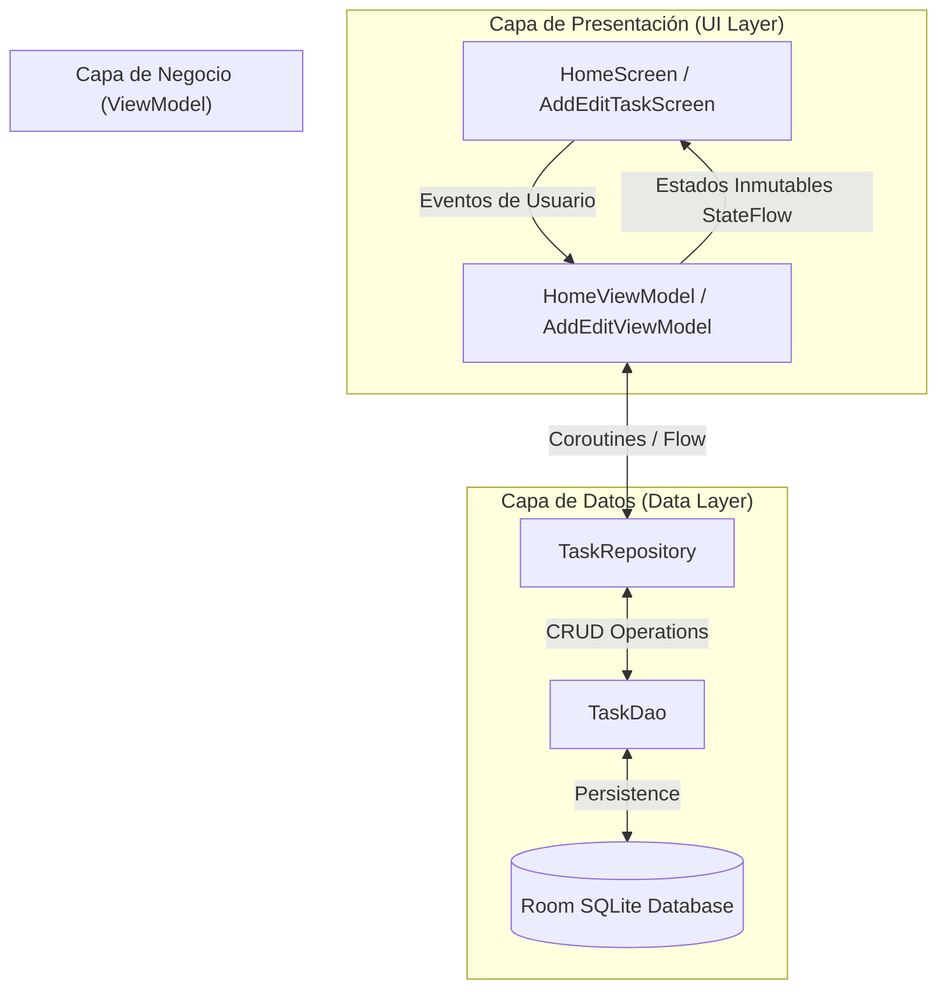

# 📱 App de Gestión de Tareas (MVVM + Room + Navigation Compose)

Aplicación Android moderna desarrollada en **Kotlin** como ejemplo práctico de la arquitectura **MVVM (Model-View-ViewModel)** utilizando **Jetpack Compose**, la base de datos local **Room** y **Navigation Compose**.

---

## 🏛️ Arquitectura del Proyecto

La aplicación sigue la arquitectura recomendada por Google para Android, estructurada en **3 capas principales** para garantizar la separación de responsabilidades, testabilidad y mantenibilidad:



### 1. Capa de Presentación (UI Layer)
- **Jetpack Compose**: Declaración de la interfaz de usuario con componentes de Material 3 (`Scaffold`, `TopAppBar`, `FloatingActionButton`, `SwipeToDismissBox`, `LazyColumn`).
- **Unidirectional Data Flow (UDF)**: La vista observa el estado emitido por el ViewModel mediante `collectAsStateWithLifecycle()` y envía los eventos del usuario de vuelta al ViewModel.

### 2. Capa de Negocio / Presentador (ViewModel)
- **ViewModels (`HomeViewModel`, `AddEditViewModel`)**: Administran el estado de la UI y la lógica de presentación.
- **UI States (`HomeUiState`, `AddEditUiState`)**: Representan el estado exacto de la pantalla en cada momento (Cargando, Éxito con Lista de Tareas, Errores de Validación).
- **`StateFlow`**: Expone el flujo de datos inmutable adaptado al ciclo de vida.

### 3. Capa de Datos (Data Layer - Room)
- **Entity (`TaskEntity`)**: Representa la tabla `tasks` en la base de datos SQLite local.
- **DAO (`TaskDao`)**: Define las operaciones CRUD y consultas SQL. Retorna `Flow<List<TaskEntity>>` para observación continua de cambios en tiempo real.
- **Room Database (`TaskDatabase`)**: Instancia única de la base de datos configurada como Singleton.
- **Repository Pattern (`TaskRepository` / `TaskRepositoryImpl`)**: Abstrae y centraliza el origen de los datos de la interfaz de usuario.

---

## 📂 Estructura del Código

```text
com.jassgroup.architecturemobileapp
├── TaskApplication.kt           # Inicialización de la DB y Repositorio (Singleton)
├── MainActivity.kt               # Actividad principal que aloja el NavGraph
├── data/
│   ├── local/
│   │   ├── entity/
│   │   │   └── TaskEntity.kt    # Entidad de la tabla 'tasks'
│   │   ├── dao/
│   │   │   └── TaskDao.kt       # Interface DAO con consultas SQL
│   │   └── database/
│   │       └── TaskDatabase.kt  # Base de datos Room
│   └── repository/
│       ├── TaskRepository.kt    # Interfaz del repositorio
│       └── TaskRepositoryImpl.kt# Implementación del repositorio
└── ui/
    ├── factory/
    │   └── AppViewModelProvider.kt # Fábrica para inyectar dependencias en ViewModels
    ├── navigation/
    │   ├── Screen.kt            # Rutas de navegación (Home, AddTask, EditTask)
    │   └── NavGraph.kt          # Configuración del NavHost
    ├── home/
    │   ├── HomeUiState.kt       # Estados de la pantalla Home (Loading, Success, Error)
    │   ├── HomeViewModel.kt     # ViewModel de la pantalla principal
    │   ├── TaskItem.kt          # Tarjeta deslizable (SwipeToDismissBox)
    │   └── HomeScreen.kt        # Pantalla con lista de tareas y FAB
    └── add_edit/
        ├── AddEditUiState.kt    # Estado del formulario
        ├── AddEditViewModel.kt  # Lógica de validación y persistencia
        └── AddEditTaskScreen.kt # Pantalla para agregar/editar tareas
```

---

## 🚀 Funcionalidades Paso a Paso

### 1. Pantalla Home (Listado de Tareas)
- **Visualización en Tiempo Real**: Observa la base de datos Room mediante `Flow`. Cualquier inserción, edición o eliminación se refleja inmediatamente sin recargar.
- **Botón Flotante (FAB)**: Ubicado en la esquina inferior derecha. Al presionarlo, navega a la pantalla para **Agregar Tarea**.
- **Acción Deslizante en cada Ítem (`SwipeToDismissBox`)**:
  - **Deslizar hacia la derecha (StartToEnd)**: Revela un fondo azul con icono de lápiz y activa la navegación hacia la pantalla de **Edición** pasando el `taskId`.
  - **Deslizar hacia la izquierda (EndToStart)**: Revela un fondo rojo con icono de basura y **Elimina** automáticamente la tarea de Room.
- **Checkbox de Estado**: Permite marcar o desmarcar la tarea como completada directamente desde la lista (aplica tachado en el título).
- **Estado Vacío**: Cuando no hay tareas registradas, se muestra una ilustración informativa.

### 2. Pantalla Agregar Tarea
- **Navegación**: Se accede mediante el botón flotante (FAB) de la pantalla Home.
- **Campos del Formulario**:
  - **Título**: Campo obligatorio.
  - **Descripción**: Campo opcional multilínia.
- **Validación**: Si el usuario intenta guardar con el campo de título vacío, se resalta el campo en rojo y se muestra un mensaje de error explícito.
- **Guardado**: Inserta la nueva tarea en la base de datos Room y navega automáticamente de regreso a la pantalla Home.

### 3. Pantalla Editar Tarea
- **Navegación con Argumentos**: Se accede al deslizar una tarjeta hacia la derecha en la pantalla Home. **Navigation Compose** transmite el `taskId` mediante la ruta `edit_task/{taskId}`.
- **Precarga de Datos**: El `AddEditViewModel` consulta el registro correspondiente por su ID en Room y rellena los campos del formulario automáticamente.
- **Actualización**: Al presionar **Actualizar Tarea**, los cambios se guardan en la base de datos local y se regresa a la pantalla principal.

---

## 🛠️ Tecnologías y Librerías Utilizadas

- **Lenguaje**: Kotlin
- **UI**: Jetpack Compose (Material 3)
- **Arquitectura**: MVVM + Repository Pattern + Unidirectional Data Flow (UDF)
- **Base de Datos Local**: Room 2.8.5 con procesamiento de símbolos KSP
- **Navegación**: Navigation Compose 2.10.2
- **Asincronía & Reactividad**: Kotlin Coroutines & StateFlow / Flow
- **Inyección de Dependencias**: Inyección manual mediante `ViewModelProvider.Factory` y `Application` class.

---

## ⚙️ Cómo Compilar y Ejecutar

1. Abre el proyecto en **Android Studio** (versión Ladybug o superior).
2. Asegúrate de tener instalado el **JDK 17/21** y el **Android SDK 35/37**.
3. Sincroniza el proyecto con los archivos de Gradle (`Sync Project with Gradle Files`).
4. Selecciona un dispositivo físico o emulador con Android 7.0 (API 24) o superior.
5. Ejecuta la aplicación presionando el botón **Run** (`Shift + F10` o botón ▶️).
