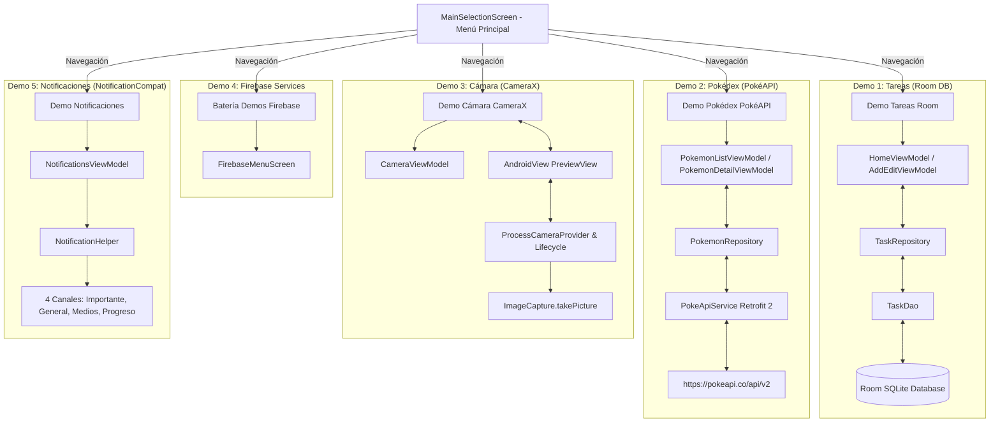

# 📱 Demos de Arquitectura Android (MVVM + Room + PokéAPI + CameraX + Firebase + Notificaciones)

Proyecto Android desarrollado en **Kotlin** para demostrar la implementación práctica de la arquitectura moderna **MVVM (Model-View-ViewModel)** en cinco módulos/demos independientes accesibles desde un **Menú Principal de Selección**, respaldado por una suite de **Pruebas Unitarias y Pruebas Instrumentales de UI (Compose Testing)**:

1. **📝 Demo Tareas / Notas**: Persistencia local con **Room Database**, flujos reactivos con **Flow** y gestos de deslizamiento (`SwipeToDismissBox`) para Editar y Eliminar.
2. **⚡ Demo Pokédex**: Consumo de API REST remota (**PokéAPI**) mediante **Retrofit 2**, carga de imágenes con **Coil**, buscador en tiempo real y pantalla de detalle con estadísticas.
3. **📷 Demo Cámara (CameraX)**: Uso de la librería oficial de **Jetpack CameraX**, vista previa en tiempo real (`PreviewView`), conmutación de lentes frontal/trasera, gestión de permisos runtime y captura de fotografías (`ImageCapture`).
4. **🔥 Batería de Demos Firebase**: Integración de **Firebase Services** (Auth, Firestore, Remote Config, Crashlytics, AI Logic Gemini).
5. **🔔 Demo Notificaciones (NotificationCompat)**: Disparo de notificaciones nativas con 4 canales (`NotificationChannel`), permiso runtime `POST_NOTIFICATIONS` (Android 13+), imágenes grandes (`BigPictureStyle`), texto extenso (`BigTextStyle`), botones de acción con `BroadcastReceiver` y barra de progreso.
6. **🧪 Suite de Pruebas Unitarias e Instrumentales**: 41 tests unitarios para ViewModels y Repositorios con **Turbine** y **MockK**, más pruebas instrumentales de UI con **Jetpack Compose Testing** y pruebas de **Room Database en memoria**.

---

## 🏛️ Arquitectura Global



---

## 📂 Estructura del Código

```text
com.jassgroup.architecturemobileapp
├── TaskApplication.kt           # Instancias únicas de Repositorios (Singleton)
├── MainActivity.kt               # Contenedor principal de Compose
├── data/                        # Capas de datos (Local y Remota)
├── util/                        # Utilidades nativas
│   ├── NotificationHelper.kt    # Helper con 4 Canales de Notificación
│   └── NotificationActionReceiver.kt # BroadcastReceiver para acciones
└── ui/                          # UI Compose, ViewModels y Estados
    ├── main_menu/MainSelectionScreen.kt # Selector inicial de demos (5 opciones)
    ├── home/                    # UI Demo Tareas (Room)
    ├── add_edit/                # UI Agregar/Editar Tarea
    ├── pokemon/                 # UI Demo Pokédex (Retrofit + Coil)
    ├── camera/                  # UI Demo Cámara (CameraX)
    ├── firebase/                # UI Batería de Demos Firebase
    └── notifications/           # UI Demo Notificaciones
        ├── NotificationsUiState.kt
        ├── NotificationsViewModel.kt
        └── NotificationsScreen.kt
src/
├── test/java/com/jassgroup/architecturemobileapp/   # PRUEBAS UNITARIAS (JVM)
│   ├── util/MainDispatcherRule.kt
│   ├── data/repository/
│   └── ui/ (Home, AddEdit, Pokemon, Camera, Firebase, Notifications)
└── androidTest/java/com/jassgroup/architecturemobileapp/ # PRUEBAS INSTRUMENTALES UI
    ├── data/local/dao/TaskDaoTest.kt
    └── ui/ (MainSelection, Home, AddEdit, Pokemon, Navigation)
```

---

## 🛠️ Tecnologías Utilizadas

- **Lenguaje**: Kotlin
- **UI**: Jetpack Compose (Material 3)
- **Notificaciones**: `NotificationCompat`, `NotificationChannel`, `POST_NOTIFICATIONS`
- **Cámara**: CameraX 1.4.1
- **Base de Datos Local**: Room 2.8.5 + KSP
- **Cliente HTTP**: Retrofit 2.11.0 + Gson Converter
- **Carga de Imágenes**: Coil Compose 2.7.0
- **Servicios de Nube**: Firebase BOM 33.9.0 (Auth, Firestore, Remote Config, Crashlytics, Vertex AI / Gemini)
- **Testing**: JUnit 4, Compose UI Testing (`createComposeRule`), Kotlinx Coroutines Test 1.11.0, Turbine 1.2.1, MockK 1.14.11.

---

## ⚙️ Compilación y Ejecución

### 1. Compilar y Ejecutar la App
Abre el proyecto en Android Studio y presiona **Run** (`Shift + F10`).

### 2. Correr Pruebas Unitarias
```bash
./gradlew test
```

### 3. Correr Pruebas Instrumentales
Conecta un emulador o dispositivo Android y ejecuta:
```bash
./gradlew connectedAndroidTest
```
