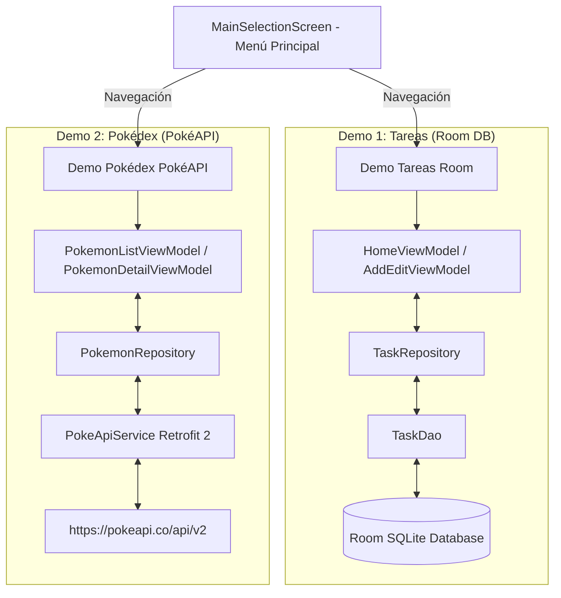

# 📱 Demos de Arquitectura Android (MVVM + Room + PokéAPI)

Proyecto Android desarrollado en **Kotlin** para demostrar la implementación práctica de la arquitectura moderna **MVVM (Model-View-ViewModel)** en dos módulos/demos independientes accesibles desde un **Menú Principal de Selección**:

1. **📝 Demo Tareas / Notas**: Persistencia local con **Room Database**, flujos reactivos con **Flow** y gestos de deslizamiento (`SwipeToDismissBox`) para Editar y Eliminar.
2. **⚡ Demo Pokédex**: Consumo de API REST remota (**PokéAPI**) mediante **Retrofit 2**, carga de imágenes con **Coil**, buscador en tiempo real y pantalla de detalle con estadísticas.

---

## 🏛️ Arquitectura Global

Ambos demos siguen los principios de **Clean Architecture** y la guía oficial de Google para Android:



---

## 📂 Estructura del Código

```text
com.jassgroup.architecturemobileapp
├── TaskApplication.kt           # Instancias únicas de Repositorios (Singleton)
├── MainActivity.kt               # Contenedor principal de Compose
├── data/
│   ├── local/                    # Persistencia Local (Room)
│   │   ├── entity/TaskEntity.kt
│   │   ├── dao/TaskDao.kt
│   │   └── database/TaskDatabase.kt
│   ├── remote/                   # Red Remota (PokéAPI)
│   │   ├── api/PokeApiService.kt
│   │   ├── api/RetrofitClient.kt
│   │   └── model/PokemonResponse.kt
│   └── repository/               # Repositorios
│       ├── TaskRepository.kt & TaskRepositoryImpl.kt
│       └── PokemonRepository.kt & PokemonRepositoryImpl.kt
└── ui/
    ├── factory/AppViewModelProvider.kt # Inyección manual de dependencias
    ├── navigation/
    │   ├── Screen.kt            # Rutas fuertemente tipadas
    │   └── NavGraph.kt          # Grafo de navegación central
    ├── main_menu/
    │   └── MainSelectionScreen.kt # Selector inicial de demos
    ├── home/                    # UI Demo Tareas
    │   ├── HomeViewModel.kt
    │   ├── HomeScreen.kt
    │   └── TaskItem.kt          # Deslizamiento (SwipeToDismissBox)
    ├── add_edit/                # UI Agregar/Editar Tarea
    │   ├── AddEditViewModel.kt
    │   └── AddEditTaskScreen.kt
    └── pokemon/                 # UI Demo Pokédex
        ├── list/
        │   ├── PokemonListViewModel.kt
        │   └── PokemonListScreen.kt (Grid + Buscador)
        └── detail/
            ├── PokemonDetailViewModel.kt
            └── PokemonDetailScreen.kt (Arte oficial, tipos y stats)
```

---

## 🚀 Funcionalidades y Demos

### 1. Menú Principal (`MainSelectionScreen`)
- Pantalla inicial que permite elegir entre los dos demos mediante tarjetas interactivas de Material 3.

### 2. Demo Tareas / Notas (Room + MVVM)
- **Carga Reactiva**: Lista de tareas actualizada en tiempo real mediante `Flow`.
- **Botón Flotante (FAB)**: Navega a la pantalla de creación.
- **Acción Deslizante (`SwipeToDismissBox`)**:
  - Deslizar a la derecha -> **Editar** tarea.
  - Deslizar a la izquierda -> **Eliminar** tarea.
- **Formulario de Agregar/Editar**: Validación del título obligatorio, edición precargada y actualización persistente.

### 3. Demo Pokédex (PokéAPI + Retrofit + Coil)
- **Listado en Grid**: Muestra las tarjetas de los primeros 151 Pokémon en 2 columnas con imágenes cargadas asíncronamente con **Coil** (`AsyncImage`).
- **Buscador en Tiempo Real**: Filtra Pokémon por nombre o por número ordinal.
- **Pantalla de Detalle**:
  - Arte oficial en alta definición.
  - Badges de tipos elementales con colores oficiales (Fuego, Agua, Planta, Eléctrico, etc.).
  - Ficha técnica de Peso y Altura.
  - Barras animadas de estadísticas base (HP, Ataque, Defensa, Velocidad, etc.).

---

## 🛠️ Tecnologías Utilizadas

- **Lenguaje**: Kotlin
- **UI**: Jetpack Compose (Material 3)
- **Navegación**: Navigation Compose 2.10.2
- **Base de Datos Local**: Room 2.8.5 + KSP
- **Cliente HTTP**: Retrofit 2.11.0 + Gson Converter
- **Carga de Imágenes**: Coil Compose 2.7.0
- **Asincronía**: Kotlin Coroutines & StateFlow

---

## ⚙️ Compilación y Ejecución

1. Abre el proyecto en **Android Studio**.
2. Sincroniza las dependencias con Gradle (`Sync Project with Gradle Files`).
3. Conecta un dispositivo físico con acceso a internet o inicia un emulador.
4. Presiona **Run** (`Shift + F10`).
