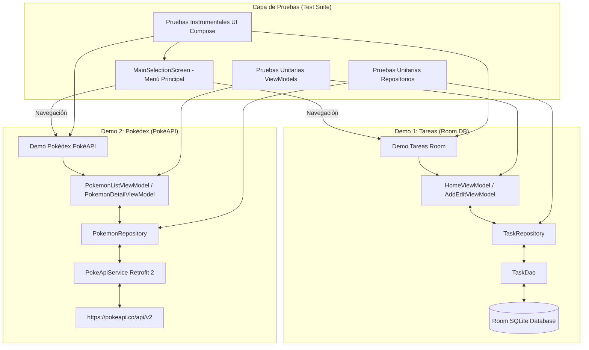

# 📱 Demos de Arquitectura Android (MVVM + Room + PokéAPI + Tests)

Proyecto Android desarrollado en **Kotlin** para demostrar la implementación práctica de la arquitectura moderna **MVVM (Model-View-ViewModel)** en dos módulos/demos independientes accesibles desde un **Menú Principal de Selección**, respaldado por una suite completa de **Pruebas Unitarias y Pruebas Instrumentales de UI (Compose Testing)**:

1. **📝 Demo Tareas / Notas**: Persistencia local con **Room Database**, flujos reactivos con **Flow** y gestos de deslizamiento (`SwipeToDismissBox`) para Editar y Eliminar.
2. **⚡ Demo Pokédex**: Consumo de API REST remota (**PokéAPI**) mediante **Retrofit 2**, carga de imágenes con **Coil**, buscador en tiempo real y pantalla de detalle con estadísticas.
3. **🧪 Suite de Pruebas Unitarias**: 26 tests unitarios para ViewModels y Repositorios con **Turbine** y **MockK**.
4. **📱 Suite de Pruebas Instrumentales UI**: Pruebas de interfaz de usuario con **Jetpack Compose Testing** (`ComposeTestRule`, `onNodeWithText`, `performClick`, `performTextInput`).

---

## 🏛️ Arquitectura Global



---

## 📂 Estructura del Código y Pruebas

```text
com.jassgroup.architecturemobileapp
├── TaskApplication.kt           # Instancias únicas de Repositorios (Singleton)
├── MainActivity.kt               # Contenedor principal de Compose
├── data/                        # Capas de datos (Local y Remota)
└── ui/                          # UI Compose, ViewModels y Estados
src/
├── test/java/com/jassgroup/architecturemobileapp/   # PRUEBAS UNITARIAS (JVM)
│   ├── util/MainDispatcherRule.kt
│   ├── data/repository/
│   │   ├── TaskRepositoryImplTest.kt
│   │   └── PokemonRepositoryImplTest.kt
│   └── ui/
│       ├── home/HomeViewModelTest.kt
│       ├── add_edit/AddEditViewModelTest.kt
│       ├── pokemon/list/PokemonListViewModelTest.kt
│       └── pokemon/detail/PokemonDetailViewModelTest.kt
└── androidTest/java/com/jassgroup/architecturemobileapp/ # PRUEBAS INSTRUMENTALES UI
    ├── data/local/dao/TaskDaoTest.kt                # Test de Room DB InMemory
    └── ui/
        ├── main_menu/MainSelectionScreenTest.kt      # Test UI Menú Principal
        ├── home/HomeScreenTest.kt                    # Test UI Pantalla Tareas
        ├── add_edit/AddEditTaskScreenTest.kt        # Test UI Formulario Tareas
        ├── pokemon/list/PokemonListScreenTest.kt    # Test UI Pokédex Grid
        ├── pokemon/detail/PokemonDetailScreenTest.kt# Test UI Detalle Pokémon
        └── navigation/NavigationComposeTest.kt      # Test Navegación End-to-End
```

---

## 🧪 Estrategia de Pruebas y Cobertura

- **Pruebas Instrumentales de UI (`ComposeTestRule`)**:
  - `MainSelectionScreenTest`: Renderizado de tarjetas e interacciones.
  - `HomeScreenTest`: Estado de lista vacía, rendering de tareas e interacción con FAB.
  - `AddEditTaskScreenTest`: Captura de entrada de texto en Título/Descripción y mensaje de validación.
  - `PokemonListScreenTest`: Búsqueda en tiempo real y filtrado de tarjetas.
  - `PokemonDetailScreenTest`: Renderizado de estadísticas base, tipos elementales, peso y altura.
  - `NavigationComposeTest`: Prueba de integración navegando entre las pantallas.
- **Pruebas Unitarias (`JUnit` + `MockK` + `Turbine`)**: 26 tests probando la lógica de negocio de los ViewModels y Repositorios.
- **Pruebas de Base de Datos (`TaskDaoTest`)**: Consultas e inserciones en memoria.

---

## 🛠️ Tecnologías Utilizadas

- **Lenguaje**: Kotlin
- **UI**: Jetpack Compose (Material 3)
- **Base de Datos Local**: Room 2.8.5 + KSP
- **Cliente HTTP**: Retrofit 2.11.0 + Gson Converter
- **Carga de Imágenes**: Coil Compose 2.7.0
- **Testing**: JUnit 4, Compose UI Testing (`createComposeRule`), Kotlinx Coroutines Test 1.11.0, Turbine 1.2.1, MockK 1.14.11.

---

## ⚙️ Compilación y Ejecución de Pruebas

### 1. Correr Pruebas Unitarias
```bash
./gradlew test
```

### 2. Correr Pruebas Instrumentales (UI Compose & Room DAO)
Conecta un emulador o dispositivo Android físico y ejecuta:
```bash
./gradlew connectedAndroidTest
```
