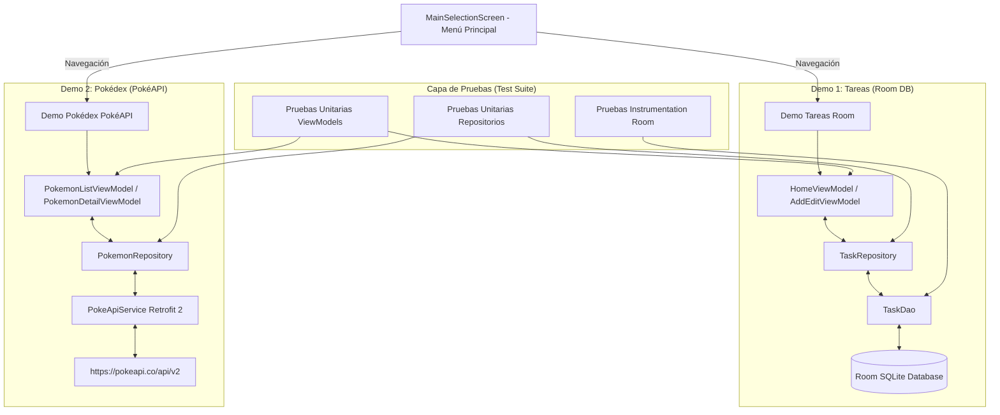

# 📱 Demos de Arquitectura Android (MVVM + Room + PokéAPI + Tests)

Proyecto Android desarrollado en **Kotlin** para demostrar la implementación práctica de la arquitectura moderna **MVVM (Model-View-ViewModel)** en dos módulos/demos independientes accesibles desde un **Menú Principal de Selección**, respaldado por una suite completa de **Pruebas Unitarias y de Integración**:

1. **📝 Demo Tareas / Notas**: Persistencia local con **Room Database**, flujos reactivos con **Flow** y gestos de deslizamiento (`SwipeToDismissBox`) para Editar y Eliminar.
2. **⚡ Demo Pokédex**: Consumo de API REST remota (**PokéAPI**) mediante **Retrofit 2**, carga de imágenes con **Coil**, buscador en tiempo real y pantalla de detalle con estadísticas.
3. **🧪 Suite Completa de Pruebas**: Tests unitarios para todos los ViewModels y Repositorios con **Turbine** y **MockK**, más pruebas de integración de la base de datos Room en memoria.

---

## 🏛️ Arquitectura Global



---

## 📂 Estructura del Código y Pruebas

```text
com.jassgroup.architecturemobileapp
├── TaskApplication.kt           # Instancias únicas de Repositorios (Singleton)
├── MainActivity.kt               # Contenedor principal de Compose
├── data/                        # Capas de datos (Local y Remota)
└── ui/                          # UI Compose, ViewModels y Estados
src/
├── test/java/com/jassgroup/architecturemobileapp/   # PRUEBAS UNITARIAS (JVM)
│   ├── util/
│   │   └── MainDispatcherRule.kt                   # Regla para probar corrutinas
│   ├── data/repository/
│   │   ├── TaskRepositoryImplTest.kt                # Test de TaskRepository
│   │   └── PokemonRepositoryImplTest.kt             # Test de PokemonRepository
│   └── ui/
│       ├── home/HomeViewModelTest.kt                # Test de HomeViewModel
│       ├── add_edit/AddEditViewModelTest.kt          # Test de AddEditViewModel
│       ├── pokemon/list/PokemonListViewModelTest.kt # Test de PokemonListViewModel
│       └── pokemon/detail/PokemonDetailViewModelTest.kt # Test de PokemonDetailViewModel
└── androidTest/java/com/jassgroup/architecturemobileapp/ # PRUEBAS DE INTEGRACIÓN
    └── data/local/dao/TaskDaoTest.kt                # Test de Room con DB InMemory
```

---

## 🧪 Estrategia de Pruebas y Cobertura

- **`HomeViewModelTest`**: Verifica la emisión de `HomeUiState.Success`, alternado de tareas (`toggleTaskCompletion`) y eliminación.
- **`AddEditViewModelTest`**: Verifica la inicialización, precarga por `taskId`, validaciones de campos vacíos e inserción/actualización en Room.
- **`PokemonListViewModelTest`**: Verifica la respuesta exitosa de PokéAPI, filtrado reactivo por nombre/ID y estados de error de red.
- **`PokemonDetailViewModelTest`**: Verifica la carga de detalles de un Pokémon por nombre/ID y el manejo de excepciones HTTP.
- **`TaskRepositoryImplTest` & `PokemonRepositoryImplTest`**: Verifican el correcto flujo de datos y manejo de la estructura `Result`.
- **`TaskDaoTest`**: Prueba las operaciones SQLite directamente en memoria (`Room.inMemoryDatabaseBuilder`).

---

## 🛠️ Tecnologías Utilizadas

- **Lenguaje**: Kotlin
- **UI**: Jetpack Compose (Material 3)
- **Base de Datos Local**: Room 2.8.5 + KSP
- **Cliente HTTP**: Retrofit 2.11.0 + Gson Converter
- **Carga de Imágenes**: Coil Compose 2.7.0
- **Testing**: JUnit 4, Kotlinx Coroutines Test 1.11.0, Turbine 1.2.1, MockK 1.14.11, AndroidX Arch Core Testing.

---

## ⚙️ Compilación y Ejecución de Pruebas

### 1. Correr Pruebas Unitarias
Para ejecutar los 26 tests unitarios de ViewModels y Repositorios desde la terminal:
```bash
./gradlew test
```

### 2. Correr Pruebas de Integración (Room DAO)
Para ejecutar la suite de pruebas de la base de datos en memoria en un emulador o dispositivo:
```bash
./gradlew connectedAndroidTest
```
