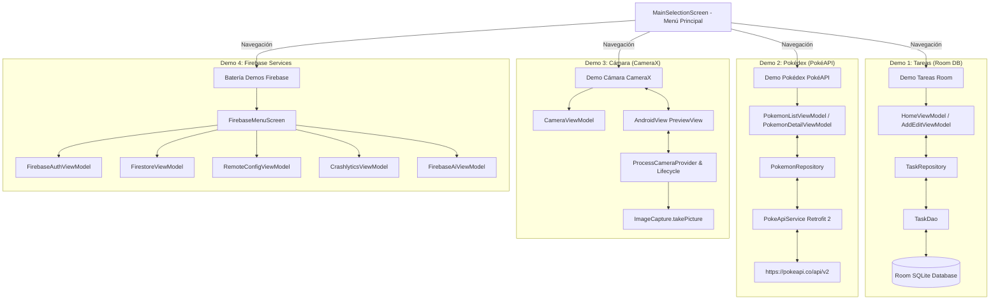

# 📱 Demos de Arquitectura Android (MVVM + Room + PokéAPI + CameraX + Firebase)

Proyecto Android desarrollado en **Kotlin** para demostrar la implementación práctica de la arquitectura moderna **MVVM (Model-View-ViewModel)** en cuatro módulos/demos independientes accesibles desde un **Menú Principal de Selección**, respaldado por una suite de **Pruebas Unitarias y Pruebas Instrumentales de UI (Compose Testing)**:

1. **📝 Demo Tareas / Notas**: Persistencia local con **Room Database**, flujos reactivos con **Flow** y gestos de deslizamiento (`SwipeToDismissBox`) para Editar y Eliminar.
2. **⚡ Demo Pokédex**: Consumo de API REST remota (**PokéAPI**) mediante **Retrofit 2**, carga de imágenes con **Coil**, buscador en tiempo real y pantalla de detalle con estadísticas.
3. **📷 Demo Cámara (CameraX)**: Uso de la librería oficial de **Jetpack CameraX**, vista previa en tiempo real (`PreviewView`), conmutación de lentes frontal/trasera, gestión de permisos runtime y captura de fotografías (`ImageCapture`).
4. **🔥 Batería de Demos Firebase**: Integración de **Firebase Services** a través del archivo `google-services.json` configurado en `app/` con 5 ejemplos interactivos:
   - **Firebase Authentication**: Inicio de sesión (Correo/Contraseña y simulación Google Gmail), Registro y Cierre de Sesión.
   - **Cloud Firestore**: Base de datos NoSQL reactiva en tiempo real con operaciones CRUD.
   - **Firebase Remote Config**: Obtención y activación de parámetros dinámicos y banderas de características desde la nube.
   - **Firebase Crashlytics**: Forzamiento de excepciones de prueba, logs personalizados y claves.
   - **Firebase AI Logic (Vertex AI / Gemini)**: Consultas e interactividad con el modelo generativo de inteligencia artificial.

---

## 🏛️ Arquitectura Global



---

## 📂 Estructura del Código

```text
com.jassgroup.architecturemobileapp
├── TaskApplication.kt           # Instancias únicas de Repositorios (Singleton)
├── MainActivity.kt               # Contenedor principal de Compose
├── data/                        # Capas de datos (Local y Remota)
└── ui/                          # UI Compose, ViewModels y Estados
    ├── main_menu/
    │   └── MainSelectionScreen.kt # Selector inicial de demos (4 opciones)
    ├── home/                    # UI Demo Tareas (Room)
    ├── add_edit/                # UI Agregar/Editar Tarea
    ├── pokemon/                 # UI Demo Pokédex (Retrofit + Coil)
    ├── camera/                  # UI Demo Cámara (CameraX)
    └── firebase/                # UI Batería de Demos Firebase
        ├── menu/FirebaseMenuScreen.kt
        ├── auth/ (FirebaseAuthScreen & ViewModel)
        ├── firestore/ (FirestoreScreen & ViewModel)
        ├── remote_config/ (RemoteConfigScreen & ViewModel)
        ├── crashlytics/ (CrashlyticsScreen & ViewModel)
        └── ai/ (FirebaseAiScreen & ViewModel)
```

---

## 🛠️ Tecnologías Utilizadas

- **Lenguaje**: Kotlin
- **UI**: Jetpack Compose (Material 3)
- **Base de Datos Local**: Room 2.8.5 + KSP
- **Cliente HTTP**: Retrofit 2.11.0 + Gson Converter
- **Carga de Imágenes**: Coil Compose 2.7.0
- **Cámara**: CameraX 1.4.1
- **Servicios de Nube**: Firebase BOM 33.9.0 (Auth, Firestore, Remote Config, Crashlytics, Vertex AI / Gemini)
- **Testing**: JUnit 4, Compose UI Testing (`createComposeRule`), Kotlinx Coroutines Test 1.11.0, Turbine 1.2.1, MockK 1.14.11.

---

## ⚙️ Compilación y Ejecución

### 1. Compilar y Ejecutar la App
Abre el proyecto en Android Studio y presiona **Run** (`Shift + F10`). El archivo `app/google-services.json` es procesado automáticamente por el plugin de Google Services.

### 2. Correr Pruebas Unitarias
```bash
./gradlew test
```

### 3. Correr Pruebas Instrumentales
Conecta un emulador o dispositivo Android y ejecuta:
```bash
./gradlew connectedAndroidTest
```
